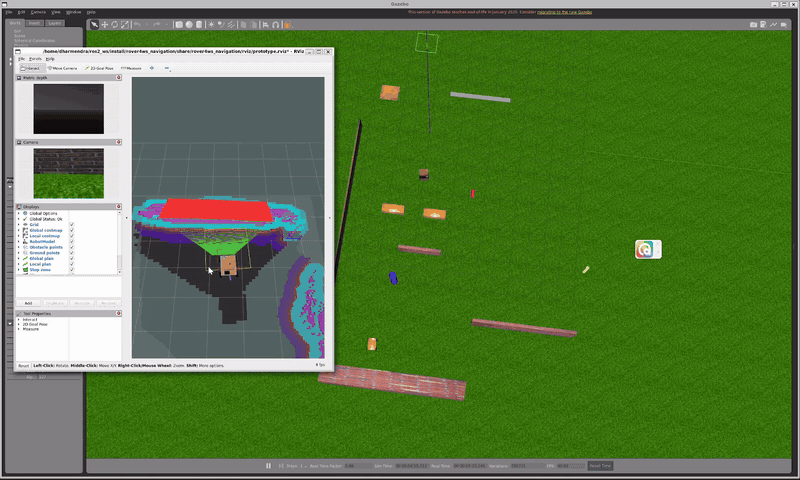
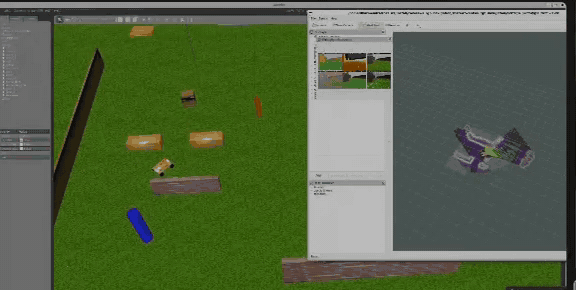

# rover4ws — camera-only navigation for a 4-wheel-steering rover

Click a goal in RViz → the rover builds a map from **one camera**, plans a car-like path and drives
there around obstacles. No LiDAR, no GPS, no prior map. Runs in Gazebo simulation (ROS 2 Humble).

There are **two perception/navigation stacks** — pick one at launch time. Both use the same robot
model, worlds, 4-wheel-steering control, wheel + IMU odometry and safety layers.

| | **A. Depth Anything V2** (v0.1) | **B. RGB-only** (v0.2) |
|---|---|---|
| How it sees | neural network predicts depth for every pixel, scaled to metres with the known camera height | SegFormer finds drivable ground, YOLO finds people/vehicles, flat-ground geometry gives distances — **no depth model** |
| Extras | — | moving-object tracking, corridor & vanishing point, optical-flow odometry, 7 visual views + dashboard |
| Planning | Nav2 (Smac Hybrid-A* + MPPI) | Nav2 global planner + custom steering-aware arc planner |
| Launch | `ros2 launch rover4ws_navigation prototype.launch.py` | `ros2 launch rover4ws_rgb_navigation rgb_prototype.launch.py` |
| Sim results | 6/6 goals, ~24 ms per frame | 4/6 goals in long sessions, ~60 ms per frame |
| Use it when | you want the most reliable navigation now | you want semantics, people tracking and the TerraMax-style views |

Full technical documentation: **[docs/](docs/README.md)**.

## Demo

Both runs are in Gazebo simulation. Click a preview to open the full video.

| **A. Depth Anything V2: depth-based navigation** | **B. RGB-only: visual odometry and perception views** |
|---|---|
| [](docs/media/depth_anything_v2_navigation.mp4) | [](docs/media/rgb_only_navigation.mp4) |
| RViz (left) shows the camera image and the **metric depth** predicted by Depth Anything V2. Obstacle points (red) and ground points (green) build the costmap as the rover drives around crates and walls to the goal. Preview is 5× speed. Full video: [1 min 40 s](docs/media/depth_anything_v2_navigation.mp4). | RViz shows the 3×2 **perception dashboard** (traversability, semantics, distance, obstacles, corridor, optical flow). The rover localizes with **optical-flow visual odometry** fused with wheels and IMU in the EKF. Preview is 3× speed. Full video: [38 s](docs/media/rgb_only_navigation.mp4). |

**Contents:** [Demo](#demo) · [1. Requirements](#1-requirements) · [2. Installation](#2-installation-once) ·
[3. Every terminal](#3-every-time-you-open-a-terminal) ·
[4A. Run Depth Anything V2](#4a-run-with-depth-anything-v2) ·
[**4B. Run RGB-only**](#4b-run-rgb-only-no-depth-model) · [5. Manual driving](#5-drive-manually-either-stack) ·
[6. Worlds](#6-test-worlds) · [7. Tests](#7-automatic-tests) · [8. Packages](#8-package-overview) ·
[9. Troubleshooting](#9-troubleshooting) · [10. Limitations](#10-known-limitations)

Installation (section 2) is the **same for both stacks** — do it once, then use 4A, 4B or both.

---

## 1. Requirements

| | |
|---|---|
| OS | **Ubuntu 22.04** (native, or WSL2 on Windows 11) |
| ROS | **ROS 2 Humble** desktop — [install guide](https://docs.ros.org/en/humble/Installation/Ubuntu-Install-Debs.html) |
| GPU | NVIDIA GPU strongly recommended (tested: RTX 4060 laptop). Without one both stacks run at only 1–3 frames/s. |
| Disk | ~6 GB (PyTorch + models) |

> **Windows users:** run every command below in the **Ubuntu terminal** (`wsl -d Ubuntu-22.04`),
> not in PowerShell. Gazebo and RViz windows open on the Windows desktop automatically (WSLg).

## 2. Installation (once)

**Step 1 — workspace and code**
```bash
mkdir -p ~/ros2_ws && cd ~/ros2_ws
git clone https://github.com/<your-account>/<this-repo>.git src
```

**Step 2 — ROS dependencies** (Gazebo, Nav2, ros2_control, robot_localization, … — read from every
`package.xml`)
```bash
sudo apt update && sudo apt install -y python3-pip python3-rosdep python3-colcon-common-extensions
sudo rosdep init 2>/dev/null; rosdep update
cd ~/ros2_ws && rosdep install --from-paths src --ignore-src -y --rosdistro humble
```

**Step 3 — Python AI packages** (PyTorch, transformers, YOLO)
```bash
python3 -m pip install --user -r ~/ros2_ws/src/requirements.txt
python3 -c "import torch; print('CUDA available:', torch.cuda.is_available())"   # want: True
```

**Step 4 — build**
```bash
source /opt/ros/humble/setup.bash
cd ~/ros2_ws && colcon build --symlink-install
```
`build/`, `install/` and `log/` are created here on your machine — they are not in the repository.

**Step 5 (optional) — load ROS automatically in every new terminal**
```bash
echo "source /opt/ros/humble/setup.bash" >> ~/.bashrc
echo "source ~/ros2_ws/install/setup.bash" >> ~/.bashrc
```

The neural-network weights download automatically on first run (internet needed once):
Depth Anything V2-Small and SegFormer-B2 to `~/.cache/huggingface`, YOLO11n to `~/.cache/rover4ws`.

## 3. Every time you open a terminal

```bash
source /opt/ros/humble/setup.bash
source ~/ros2_ws/install/setup.bash
```
(skip if you did Step 5). After changing code: `cd ~/ros2_ws && colcon build --symlink-install`.

---

## 4A. Run with Depth Anything V2

**Setup needed for this stack:** sections 2 and 3. It uses PyTorch + transformers (from
`requirements.txt`); the Depth Anything V2-Small model (~100 MB) downloads on the first run.
Check: `python3 -c "import torch, transformers; print('ok')"`

**Run** (copy-paste into the Ubuntu terminal):
```bash
source /opt/ros/humble/setup.bash
source ~/ros2_ws/install/setup.bash
ros2 launch rover4ws_navigation prototype.launch.py                      # crate course
# or
ros2 launch rover4ws_navigation prototype.launch.py world:=stone_yard    # stones, rocks, moving people
```

1. Gazebo and RViz open. Wait **~20–30 s** until the terminal shows
   `depth pipeline … ms/frame` (perception is running) and `Managed nodes are active` (Nav2 is ready).
2. In RViz click **2D Goal Pose** (top toolbar), click a target on the ground and **drag the arrow in
   the direction you want the rover to face when it arrives**. This is a car-like robot: asking it to
   arrive facing backwards makes it drive a loop.
3. The rover plans (blue line) and drives there.

What you see in RViz: camera image and **metric depth image**, red = obstacle points, green = ground
points, global and local costmaps (grey = unexplored), blue = planned path, red / yellow = stop / slow zones.

Useful options:

| Option | Default | Meaning |
|---|---|---|
| `world:=` | `test_yard` | `test_yard` (crates, wall, gap) or `stone_yard` (gravel, rocks, walker, cart) |
| `depth_source:=gt` | `model` | use the simulator's perfect depth camera instead of the network (debugging) |
| `use_vo:=false` | `true` | turn off visual odometry |
| `gui:=false` | `true` | no Gazebo window (faster) |
| `rviz:=false` | `true` | no RViz |
| `x:= y:= yaw:=` | `0` | start position |

## 4B. Run RGB-only (no depth model)

**Setup needed for this stack:** sections 2 and 3 — nothing extra. It uses PyTorch + transformers
(SegFormer) + **ultralytics** (YOLO), all in `requirements.txt`. On the first run it downloads
SegFormer-B2 (~100 MB, to `~/.cache/huggingface`) and YOLO11n (~6 MB, to `~/.cache/rover4ws`).
Check: `python3 -c "import torch, transformers, ultralytics; print('ok')"`
If `ultralytics` is missing: `python3 -m pip install --user ultralytics "numpy<2"`

**Run** (copy-paste into the Ubuntu terminal):
```bash
source /opt/ros/humble/setup.bash
source ~/ros2_ws/install/setup.bash
ros2 launch rover4ws_rgb_navigation rgb_prototype.launch.py                      # stone yard (default)
# or
ros2 launch rover4ws_rgb_navigation rgb_prototype.launch.py world:=test_yard     # crate course
```

**Optional — watch the perception views full-size** (second Ubuntu terminal):
```bash
source /opt/ros/humble/setup.bash
ros2 run rqt_image_view rqt_image_view     # choose e.g. /rgb/dashboard or /rgb/view/distance
```

**Steps after launching:**

1. Wait **~20–30 s** until the terminal shows `rgb pipeline … ms/frame` and `steering_planner ready`.
2. In RViz use **2D Goal Pose** exactly as above (drag the arrow in the direction of travel).
3. The rover plans (blue line), shows its candidate steering arcs (green = free, red = blocked,
   blue = chosen) and drives there. It slows and stops for people, drives over small stones,
   goes around rocks, and does a three-point turn when the goal is behind it.

**Perception views** — RViz shows the **dashboard** (6 views); each view is also its own topic
(open it with `rqt_image_view`, see above):

| Topic | Shows |
|---|---|
| `/rgb/dashboard` | all of the below in one 3×2 image |
| `/rgb/view/traversability` | teal = free, orange = small stones (drivable), yellow = obstacles, magenta = people |
| `/rgb/view/semantic` | SegFormer classes with legend |
| `/rgb/view/distance` | distance heatmap (red near → blue far), from flat-ground geometry |
| `/rgb/view/obstacles` | each obstacle in its own colour with its distance |
| `/rgb/view/vanishing` | path edges, vanishing point, corridor centre line |
| `/rgb/view/detections` | YOLO boxes with track id, distance, MOVING flag |
| `/rgb/view/flow` | optical-flow arrows and live odometry speed |

Options: `world:=`, `use_vo:=`, `gui:=`, `rviz:=`, `x:= y:= yaw:=` (same meaning as above).

## 5. Drive manually (either stack)

```bash
ros2 run teleop_twist_keyboard teleop_twist_keyboard
```
`i` forward · `,` back · `u`/`o` forward-left/right · `k` stop · `Shift+U`/`Shift+O` diagonal crab.
Keep that terminal focused. ⚠ Manual driving bypasses the planner **and** the safety layers.

## 6. Test worlds

| `world:=` | Contents |
|---|---|
| `test_yard` | crate in the way, two crates with a 1.2 m gap, a wall, a standing person; an invisible ice patch at (2–9, 4.5–9.5) for wheel-slip tests |
| `stone_yard` | 40 pebbles 1.5–3.5 cm (drive over), 7 rocks 35–65 cm (avoid), a person walking across the path, a moving cart. Goal suggestion: (14, 0) then back |

The walker and cart are animations: the camera sees them but they never dodge and have no collision.
To rearrange the stone yard edit `rover4ws_gazebo/worlds/make_stone_yard.py`, run it, rebuild.

## 7. Automatic tests

With a stack running headless (`gui:=false rviz:=false`) in one terminal, in another:
```bash
cd ~/ros2_ws/src/rover4ws_navigation/tools
python3 nav_test.py --x 12 --y 0                       # go to a goal, report time, error, clearances
python3 nav_test.py --world stone_yard --x 14 --y 0
python3 safety_test.py                                 # A: sudden obstacle, perception loss
python3 safety_test.py --kill rgb_perception_node.py   # same for B
python3 eval_odometry.py --pattern loop                # start the stack with x:=-8.0 y:=-10.0
python3 eval_depth.py --frames 40 --drive              # A only, start with gt_depth:=true
```
Methods and baseline numbers: [docs/07](docs/07_testing_and_results.md).

## 8. Package overview

| Package | Used by | Contents |
|---|---|---|
| `rover4ws_description` | A, B | robot model (URDF): deck, 4 steered wheels, camera, IMU, GPS |
| `rover4ws_gazebo` | A, B | worlds, ros2_control, `four_ws_kinematics.py` (speed + turn → 4 steering angles + 4 wheel speeds) |
| `rover4ws_localization` | A, B | 4WS wheel odometry, EKF (wheels + IMU + visual odometry) |
| `rover4ws_navigation` | A (B uses its safety gate + tools) | Nav2 config, behaviour trees, `safety_gate.py`, `prototype.launch.py`, test tools |
| `rover4ws_perception` | A | `depth_node.py` (Depth Anything V2), `visual_odometry.py` |
| `rover4ws_rgb_perception` | B | SegFormer, YOLO, free-space scan, corridor, optical flow, tracker, views |
| `rover4ws_rgb_navigation` | B | steering-aware arc planner, Nav2 global planner config, `rgb_prototype.launch.py` |

Git tags: `v0.1-depth-anything`, `v0.2-rgb-only`.

## 9. Troubleshooting

| Problem | Fix |
|---|---|
| `&&` / `source` errors | you are in PowerShell — open the Ubuntu terminal |
| `executable '….py' not found on the libexec directory` | the script lost its executable bit (common when editing from Windows): run `colcon build` again (it restores it) or `chmod +x ~/ros2_ws/src/*/scripts/*.py` |
| Gazebo exits immediately (code 255) | an old Gazebo is still running: `pkill -9 gzserver` |
| colcon fails after a pip install | `python3 -m pip install --user "setuptools<80"` |
| numpy / cv_bridge errors | `python3 -m pip install --user "numpy<2"` |
| `CUDA available: False` | install the NVIDIA driver (WSL: Windows driver only); everything still runs, slowly |
| RViz is empty / nothing moves | wait for the ready messages (§4A / §4B step 1) before sending a goal |
| Rover circles near the goal | the goal arrow points backwards — drag it in the direction of travel |
| A SciPy warning about NumPy at start-up | harmless |

## 10. Known limitations

- Tested in **simulation only**. Gazebo images are far cleaner than real camera images; both stacks
  must be re-validated on real footage before driving the real rover.
- **Flat ground assumed** for distances (both stacks) — slopes and kerbs distort them.
- **Forward camera only** (~100°): nothing protects the sides and rear.
- Car-like turning only (±35° steering, ~0.64 m minimum radius): no turning on the spot, no pure sideways motion.
- No GPS yet: goals are relative to where the rover started.
- Robot dimensions were estimated from photos — measure the real robot and update
  `rover4ws_description/urdf/properties.xacro` ([docs/02](docs/02_robot_model.md)).

Details and the real-robot plan: [docs/10](docs/10_roadmap_real_robot.md), [docs/11](docs/11_rgb_only_prototype.md).
