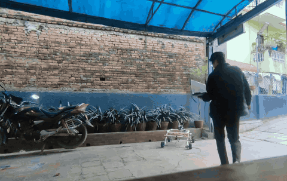

<div align="center">

# rover4ws

**Camera-only navigation for a 4-wheel-steering rover**

One camera → map → car-like path → drive to the goal around obstacles.
No LiDAR, no GPS, no prior map.


<a href="docs/media/real_robot_visual_odometry.mp4">
  
</a>

*First run on the real rover — localization from **visual odometry only** (4× speed,
[full video](docs/media/real_robot_visual_odometry.mp4)).*

</div>

---

## Highlights

- **One RGB camera is the only perception sensor** — no LiDAR, depth camera or GPS.
- **Two interchangeable stacks:** neural depth (Depth Anything V2) or RGB-only semantics (SegFormer + YOLO).
- **Visual odometry** fused with wheel odometry and IMU in an EKF (simulation); visual odometry alone on the real rover.
- **4-wheel-steering aware:** car-like Hybrid-A\* / arc planning, three-point turns, ±35° steering.
- **Independent safety layer** that stops the rover on close obstacles or lost perception.

## Demos

| Real rover — visual odometry | Sim A — Depth Anything V2 | Sim B — RGB-only |
|:---:|:---:|:---:|
| [](docs/media/real_robot_visual_odometry.mp4) | [](docs/media/depth_anything_v2_navigation.mp4) | [](docs/media/rgb_only_navigation.mp4) |
| Physical rover in a courtyard. Pose from the camera only. | Predicted metric depth → obstacle (red) and ground (green) points → costmap → goal. | 3×2 perception dashboard + optical-flow visual odometry. |
| [3 min 51 s](docs/media/real_robot_visual_odometry.mp4) | [1 min 40 s](docs/media/depth_anything_v2_navigation.mp4) | [38 s](docs/media/rgb_only_navigation.mp4) |

## How it works

```
 camera ──► perception ──► local map ──► planner ──► safety gate ──► 4WS kinematics ──► wheels
   │                                        ▲
   └──► visual odometry ──► EKF (+ wheels, IMU) ──┘
```

Both stacks share the robot model, worlds, 4WS control, localization and safety layers. Pick one at launch:

| | **A. Depth Anything V2** (v0.1) | **B. RGB-only** (v0.2) |
|---|---|---|
| Perception | neural network predicts per-pixel depth, scaled to metres using the known camera height | SegFormer finds drivable ground, YOLO finds people/vehicles, flat-ground geometry gives distance |
| Extras | — | object tracking, corridor / vanishing point, optical-flow odometry, 7 visual views |
| Planner | Nav2 (Smac Hybrid-A\* + MPPI) | Nav2 global planner + steering-aware arc planner |
| Sim result | 6/6 goals · ~24 ms/frame | 4/6 goals (long sessions) · ~60 ms/frame |
| Best for | most reliable navigation today | semantics and people tracking |

## Quick start

**Requirements:** Ubuntu 22.04 (native or WSL2) · [ROS 2 Humble](https://docs.ros.org/en/humble/Installation/Ubuntu-Install-Debs.html) ·
NVIDIA GPU recommended (tested on RTX 4060 laptop; CPU-only runs at 1–3 fps) · ~6 GB disk.

```bash
# 1. Clone — the repository is the ROS 2 workspace
git clone https://github.com/Dharmendra016/visual_odometry.git ~/ros2_ws
cd ~/ros2_ws

# 2. ROS dependencies (Gazebo, Nav2, ros2_control, robot_localization, …)
sudo apt update && sudo apt install -y python3-pip python3-rosdep python3-colcon-common-extensions
sudo rosdep init 2>/dev/null; rosdep update
rosdep install --from-paths src --ignore-src -y --rosdistro humble

# 3. Python AI packages (PyTorch, transformers, YOLO)
python3 -m pip install --user -r requirements.txt
python3 -c "import torch; print('CUDA:', torch.cuda.is_available())"   # want: True

# 4. Build
source /opt/ros/humble/setup.bash
colcon build --symlink-install
source install/setup.bash
```

Model weights download automatically on first run (Depth Anything V2-Small, SegFormer-B2, YOLO11n).

> **Tip:** add `source /opt/ros/humble/setup.bash` and `source ~/ros2_ws/install/setup.bash` to
> `~/.bashrc` so every new terminal is ready. On Windows, run everything in the **Ubuntu (WSL)
> terminal**, not PowerShell.

## Run

```bash
# Stack A — Depth Anything V2
ros2 launch rover4ws_navigation prototype.launch.py                      # crate course
ros2 launch rover4ws_navigation prototype.launch.py world:=stone_yard    # rocks + moving people

# Stack B — RGB-only
ros2 launch rover4ws_rgb_navigation rgb_prototype.launch.py              # stone yard (default)
ros2 launch rover4ws_rgb_navigation rgb_prototype.launch.py world:=test_yard
```

1. Wait **~20–30 s** until the terminal prints `depth pipeline … ms/frame` (A) or
   `steering_planner ready` (B).
2. In RViz click **2D Goal Pose**, click on the ground and **drag the arrow in the direction of
   travel** (the rover is car-like — a backwards arrow makes it drive a loop).
3. The rover plans (blue line) and drives to the goal.

<details>
<summary><b>Launch options</b></summary>

| Option | Default | Meaning |
|---|---|---|
| `world:=` | A: `test_yard` · B: `stone_yard` | test world (see below) |
| `use_vo:=false` | `true` | disable visual odometry |
| `depth_source:=gt` | `model` | A only — use the simulator's perfect depth (debugging) |
| `gui:=false` | `true` | no Gazebo window (faster) |
| `rviz:=false` | `true` | no RViz |
| `x:= y:= yaw:=` | `0` | start pose |

| World | Contents |
|---|---|
| `test_yard` | crates, a 1.2 m gap, a wall, a standing person, a hidden ice patch for wheel-slip tests |
| `stone_yard` | 40 pebbles (drive over), 7 rocks (avoid), a walking person, a moving cart |

</details>

<details>
<summary><b>Perception views (stack B)</b></summary>

RViz shows the dashboard. Open any view full-size with `ros2 run rqt_image_view rqt_image_view`.

| Topic | Shows |
|---|---|
| `/rgb/dashboard` | all views in one 3×2 image |
| `/rgb/view/traversability` | free · small stones · obstacles · people |
| `/rgb/view/semantic` | SegFormer classes |
| `/rgb/view/distance` | distance heatmap (red near → blue far) |
| `/rgb/view/obstacles` | obstacle instances with distance |
| `/rgb/view/vanishing` | path edges, vanishing point, corridor |
| `/rgb/view/detections` | YOLO boxes, track id, distance, moving flag |
| `/rgb/view/flow` | optical-flow arrows and odometry speed |

</details>

<details>
<summary><b>Manual driving</b></summary>

```bash
ros2 run teleop_twist_keyboard teleop_twist_keyboard
```
`i` forward · `,` back · `u`/`o` forward-left/right · `k` stop · `Shift+U`/`Shift+O` crab.
⚠ Manual driving bypasses the planner **and** the safety layers.

</details>

<details>
<summary><b>Automatic tests</b></summary>

Start a stack headless (`gui:=false rviz:=false`), then in another terminal:

```bash
cd ~/ros2_ws/src/rover4ws_navigation/tools
python3 nav_test.py --x 12 --y 0                       # reach a goal; time, error, clearances
python3 safety_test.py                                 # sudden obstacle, perception loss (A)
python3 safety_test.py --kill rgb_perception_node.py   # same for B
python3 eval_odometry.py --pattern loop                # odometry drift
python3 eval_depth.py --frames 40 --drive              # depth accuracy (A)
```
Methods and baseline numbers: [docs/07](docs/07_testing_and_results.md).

</details>

<details>
<summary><b>Troubleshooting</b></summary>

| Problem | Fix |
|---|---|
| `&&` / `source` errors | you are in PowerShell — use the Ubuntu terminal |
| `executable '….py' not found` | `chmod +x ~/ros2_ws/src/*/scripts/*.py` or rebuild |
| Gazebo exits immediately (code 255) | `pkill -9 gzserver` |
| colcon fails after a pip install | `python3 -m pip install --user "setuptools<80"` |
| numpy / cv_bridge errors | `python3 -m pip install --user "numpy<2"` |
| `CUDA: False` | install the NVIDIA driver (WSL: Windows driver only) |
| Rover circles near the goal | goal arrow points backwards — drag it in the direction of travel |

</details>

## Repository layout

```
.
├── src/
│   ├── rover4ws_description/     robot model (URDF): chassis, 4 steered wheels, camera, IMU
│   ├── rover4ws_gazebo/          worlds, ros2_control, 4WS kinematics
│   ├── rover4ws_localization/    wheel odometry + EKF (wheels, IMU, visual odometry)
│   ├── rover4ws_perception/      A: Depth Anything V2 depth node, visual odometry
│   ├── rover4ws_navigation/      A: Nav2 config, safety gate, launch, test tools
│   ├── rover4ws_rgb_perception/  B: SegFormer, YOLO, corridor, optical flow, tracker, views
│   └── rover4ws_rgb_navigation/  B: steering-aware arc planner, launch
├── docs/                         full technical documentation + media
└── requirements.txt              Python packages not installed by rosdep
```

Full documentation — architecture, perception, localization, navigation, results and lessons
learned — is in **[docs/](docs/README.md)**.

## Limitations

- Navigation is validated in **simulation**; the real rover has so far run visual odometry only.
- **Flat ground** is assumed for distance estimates — slopes and kerbs distort them.
- **Forward camera only** (~100° FOV): no protection at the sides or rear.
- Car-like motion only (min. turning radius ~0.64 m) — no spin-in-place.
- No GPS yet: goals are relative to the start pose.

## Roadmap — from one camera to LiDAR

We are deliberately climbing a **sensor ladder**, starting with the cheapest setup and adding
hardware only when the previous step is shown to be not enough. The goal is to find the
**minimum sensing, compute and cost** that still navigates safely.

| Step | Sensing | What it adds | Status |
|:---:|---|---|---|
| 1 | **RGB visual odometry** | ego-motion from a single cheap camera | ✅ sim + real rover |
| 2 | **Monocular depth** (Depth Anything V2) | metric depth and obstacles from the same camera | ✅ sim |
| 3 | **Depth camera** (RGB-D / stereo) | measured depth — less compute, more reliable range | 🔜 next |
| 4 | **LiDAR** | precise long-range geometry | 🔜 only if needed |

Each step trades a little more hardware for less guesswork — and we only take it when the data says we must.
Details: [docs/10 — roadmap & real-robot bring-up](docs/10_roadmap_real_robot.md).
